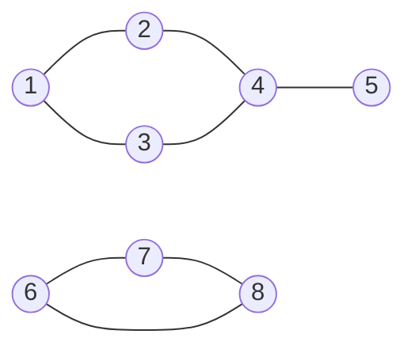
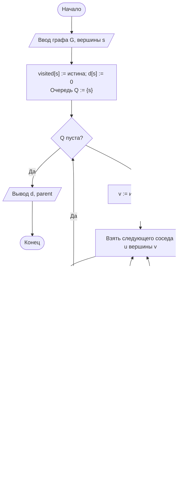

# Лабораторная работа № 9

## Способы представления графов и алгоритмы обхода в ширину и в глубину

**Дисциплина:** Теория алгоритмов
**Направление подготовки:** 38.03.05 «Бизнес-информатика»
**Курс:** 2
**Объём:** 4 академических часа
**Язык реализации:** Python 3.10+
**Предварительные требования:** ЛР № 6 (стек и очередь)

---

## 1. Цель и задачи работы

**Цель работы:** изучить способы представления графов в памяти, реализовать алгоритмы обхода в ширину и в глубину и экспериментально установить, как выбор представления влияет на расход памяти и время решения типовых задач на графах.

**Задачи:**

1. Изучить основные понятия теории графов и два способа их представления.
2. Реализовать матрицу смежности и списки смежности с одинаковым интерфейсом.
3. Реализовать обход в ширину (BFS) и обход в глубину (DFS).
4. Решить задачи поиска компонент связности, кратчайшего пути по числу рёбер и обнаружения цикла.
5. Сравнить оба представления по времени обхода и расходу памяти на разреженных и плотных графах.

---

## 2. Теоретическая часть

### 2.1. Основные понятия

**Граф** $G = (V, E)$ задаётся множеством вершин $V$ и множеством рёбер $E \subseteq V \times V$. Обозначим $\lvert V \rvert = n$, $\lvert E \rvert = m$.

| Понятие | Определение |
|---|---|
| Ориентированный граф | Рёбра имеют направление (дуги) |
| Взвешенный граф | Каждому ребру сопоставлено число (вес) |
| Степень вершины | Число инцидентных ей рёбер |
| Путь | Последовательность вершин, соединённых рёбрами |
| Цикл | Путь, начинающийся и заканчивающийся в одной вершине |
| Связность | Между любой парой вершин существует путь |
| Компонента связности | Максимальное связное подмножество вершин |

**Плотность графа.** Для неориентированного графа $0 \le m \le \frac{n(n-1)}{2}$. Граф называют **разреженным**, если $m = O(n)$, и **плотным**, если $m = \Theta(n^2)$. Большинство прикладных графов (организационные структуры, сети поставок, связи между документами) разрежены.

**Примеры графов в бизнес-информатике:** схема бизнес-процесса, сеть поставщиков и покупателей, структура подчинённости, зависимости между работами проекта, переходы пользователей между страницами сайта.

### 2.2. Матрица смежности

Квадратная матрица $A$ размера $n \times n$, где $A[i][j] = 1$, если существует ребро $(i, j)$, иначе 0. Для взвешенного графа вместо единицы хранится вес.

| Характеристика | Значение |
|---|---|
| Память | $\Theta(n^2)$ независимо от числа рёбер |
| Проверка наличия ребра | $\Theta(1)$ |
| Перебор соседей вершины | $\Theta(n)$ |
| Полный обход | $\Theta(n^2)$ |

### 2.3. Списки смежности

Для каждой вершины хранится список смежных с нею вершин.

| Характеристика | Значение |
|---|---|
| Память | $\Theta(n + m)$ |
| Проверка наличия ребра | $\Theta(\deg v)$ |
| Перебор соседей вершины | $\Theta(\deg v)$ |
| Полный обход | $\Theta(n + m)$ |

**Сравнение.** Для разреженного графа при $n = 10^4$ и $m = 3 \cdot 10^4$ матрица смежности требует $10^8$ ячеек, тогда как списки — около $4 \cdot 10^4$. Различие в тысячи раз. Матрица оправдана лишь для плотных графов и при частых проверках наличия конкретного ребра.

### 2.4. Обход в ширину

Обход в ширину (breadth-first search, BFS) посещает вершины в порядке возрастания расстояния от стартовой, измеряемого числом рёбер. Используется **очередь**.

```
BFS(G, s)
1  пометить s как посещённую; d[s] = 0
2  поместить s в очередь Q
3  пока Q не пуста
4      v = извлечь из Q
5      для каждой вершины u, смежной с v
6          если u не посещена
7              пометить u; d[u] = d[v] + 1; parent[u] = v
8              поместить u в Q
```

**Свойство.** BFS находит кратчайшие пути в **невзвешенном** графе. Массив `parent` позволяет восстановить сам путь.

**Трудоёмкость:** $\Theta(n + m)$ для списков смежности и $\Theta(n^2)$ для матрицы.

### 2.5. Обход в глубину

Обход в глубину (depth-first search, DFS) идёт вглубь, пока есть непосещённые соседи, затем возвращается назад. Используется **стек** (явный либо стек вызовов при рекурсивной реализации).

Применения: поиск компонент связности, обнаружение циклов, топологическая сортировка (ЛР № 10), поиск мостов и точек сочленения.

**Обнаружение цикла.** В ориентированном графе цикл существует тогда и только тогда, когда при обходе встречается ребро в вершину, которая находится в состоянии «в процессе обработки» (серая вершина в терминологии трёх цветов [1]). В неориентированном графе достаточно встретить посещённую вершину, не являющуюся непосредственным предком.

**Глубина рекурсии.** Для графа-цепочки из $10^5$ вершин рекурсивный DFS вызовет переполнение стека. Поэтому в работе используется итеративная реализация с явным стеком.

### 2.6. Сравнение обходов

| Признак | BFS | DFS |
|---|---|---|
| Структура данных | Очередь | Стек |
| Порядок посещения | По уровням | Вглубь |
| Кратчайший путь (невзвешенный граф) | Находит | Не находит |
| Память | $O(n)$ (может хранить весь уровень) | $O(h)$, $h$ — глубина |
| Типичные задачи | Расстояния, уровни иерархии | Циклы, компоненты, топологическая сортировка |

---

## 3. Порядок выполнения работы

1. Изучить теоретическую часть.
2. Реализовать два класса графа с одинаковым интерфейсом (`add_edge`, `neighbors`, `has_edge`): на матрице смежности и на списках смежности.
3. Реализовать BFS и DFS (итеративный) для обоих представлений.
4. Проверить работу алгоритмов на малом графе (8–12 вершин) с выводом порядка обхода и дерева обхода.
5. Сгенерировать графы согласно варианту (табл. 1) и измерить время полного обхода и расход памяти для обоих представлений.
6. Решить задачи варианта: компоненты связности, кратчайший путь, обнаружение цикла и др.
7. Построить графики зависимости времени обхода от $n$ для разреженного и плотного графов.
8. Оформить отчёт.

---

## 4. Варианты заданий

**Таблица 1. Типы графов**

| Код | Тип | Параметры |
|---|---|---|
| Р | Разреженный | $m \approx 3n$, рёбра случайны |
| П | Плотный | $m \approx 0{,}3 \, n^2$ |
| Д | Дерево | $m = n - 1$, связный, без циклов |
| Ц | Цепочка | Линейный граф (худший случай для глубины рекурсии) |
| К | Несколько компонент | 5 независимых подграфов |

**Таблица 2. Исходные данные**

| № | Тип графа | Ориентированность | Размеры $n$ | Задача варианта | Доп. |
|---|---|---|---|---|---|
| 0 | Р и П | Неориентированный | 100; 500; 1000; 2000 | Компоненты связности | — |
| 1 | Р | Ориентированный | 500; 1000; 2000 | Обнаружение цикла | И1 |
| 2 | П | Неориентированный | 100; 300; 600; 1000 | Кратчайший путь (BFS) | И2 |
| 3 | К | Неориентированный | 1000; 2000; 4000 | Число и размеры компонент | И3 |
| 4 | Д | Неориентированный | 1000; 5000; 10 000 | Высота дерева и число листьев | И4 |
| 5 | Ц | Ориентированный | 1000; 10 000; 100 000 | Сравнение рекурсивного и итеративного DFS | И5 |
| 6 | Р | Ориентированный | 1000; 2000; 5000 | Достижимые вершины из заданной | И6 |
| 7 | П | Ориентированный | 100; 300; 600 | Обнаружение цикла | И7 |
| 8 | Р и П | Неориентированный | 200; 500; 1000 | Диаметр графа (BFS из каждой вершины) | И1 |
| 9 | К | Ориентированный | 1000; 3000; 5000 | Компоненты слабой связности | И2 |
| 10 | Д | Неориентированный | 2000; 5000; 10 000 | Расстояния от корня | И3 |
| 11 | Р | Неориентированный | 1000; 2000; 4000 | Проверка двудольности | И4 |
| 12 | П | Неориентированный | 100; 400; 800 | Компоненты связности | И5 |
| 13 | Ц | Неориентированный | 5000; 50 000; 100 000 | Глубина обхода и память | И6 |
| 14 | Р | Ориентированный | 500; 2000; 5000 | Обнаружение цикла | И7 |
| 15 | К | Неориентированный | 2000; 4000; 8000 | Наибольшая компонента | И1 |
| 16 | Р и П | Ориентированный | 200; 600; 1000 | Достижимость между парами вершин | И2 |
| 17 | Д | Неориентированный | 1000; 5000; 10 000 | Центр дерева | И3 |
| 18 | П | Неориентированный | 100; 300; 700 | Кратчайший путь и его восстановление | И4 |
| 19 | Р | Неориентированный | 1000; 3000; 6000 | Проверка связности | И5 |
| 20 | К | Ориентированный | 1000; 2000; 5000 | Число компонент | И6 |
| 21 | Ц и Д | Неориентированный | 10 000; 50 000 | Сравнение BFS и DFS по памяти | И7 |
| 22 | Р | Ориентированный | 2000; 4000; 8000 | Вершины без входящих рёбер | И1 |
| 23 | П | Неориентированный | 200; 500; 900 | Диаметр графа | И2 |
| 24 | Д | Неориентированный | 5000; 10 000; 20 000 | Число вершин на каждом уровне | И3 |
| 25 | Р | Неориентированный | 1000; 2000; 5000 | Проверка двудольности | И4 |
| 26 | К | Неориентированный | 3000; 6000; 9000 | Размеры всех компонент | И5 |
| 27 | П | Ориентированный | 100; 400; 800 | Достижимые вершины | И6 |
| 28 | Ц | Ориентированный | 10 000; 100 000 | Предельная глубина рекурсии | И7 |
| 29 | Р и Д | Неориентированный | 1000; 5000; 10 000 | Кратчайший путь и число компонент | И1 |
| 30 | Все типы | Оба варианта | 500; 1000; 2000 | Сводное сравнение представлений | И3 |

**Таблица 3. Дополнительные задания**

| Код | Содержание |
|---|---|
| И1 | Измерить расход памяти обоих представлений (`sys.getsizeof` с обходом вложенных объектов) при $n = 1000$ для разреженного и плотного графа. Построить столбчатую диаграмму |
| И2 | Восстановить и вывести сам кратчайший путь по массиву `parent`, а не только его длину |
| И3 | Визуализировать малый граф (до 15 вершин) средствами Mermaid или `networkx` и выделить на нём дерево обхода |
| И4 | Реализовать проверку двудольности графа раскраской в два цвета при BFS. Объяснить связь с задачей распределения ресурсов по двум группам |
| И5 | Сравнить рекурсивный и итеративный DFS. Определить $n$, при котором рекурсивная версия вызывает `RecursionError`, и способы обхода этого ограничения |
| И6 | Построить график зависимости времени обхода от плотности графа при фиксированном $n$ (доля рёбер от максимума: 1 %, 5 %, 20 %, 50 %, 100 %). Найти точку, где матрица становится выгоднее списков |
| И7 | Сформулировать прикладную задачу (анализ схемы бизнес-процесса) и найти в ней недостижимые шаги, а также циклы, указывающие на ошибки проектирования |

---

## 5. Требования к отчёту

1. Титульный лист.
2. Цель работы и задание варианта.
3. Описание представлений графа и их теоретические оценки.
4. Изображение тестового графа и результат его обхода.
5. Блок-схемы BFS и DFS.
6. Листинг программы.
7. Таблицы измерений (время, память) и графики.
8. Результат решения задачи варианта.
9. Выводы с рекомендацией по выбору представления.

---

## 6. Пример оформления отчёта (вариант 0)

### 6.1. Задание

Реализовать матрицу смежности и списки смежности, BFS и DFS. На неориентированных графах при $n = 100, 500, 1000, 2000$ (разреженный $m \approx 3n$ и плотный $m \approx 0{,}3n^2$) измерить время полного обхода и расход памяти. Найти компоненты связности.

### 6.2. Тестовый граф



Граф содержит две компоненты связности: $\{1, 2, 3, 4, 5\}$ и $\{6, 7, 8\}$.

### 6.3. Блок-схема обхода в ширину



### 6.4. Листинг программы

```python
"""
Лабораторная работа № 9. Вариант 0.
Матрица смежности и списки смежности; BFS, DFS, компоненты связности.
"""
import random
import time
from collections import deque


class MatrixGraph:
    """Граф на матрице смежности. Память Θ(n²)."""

    def __init__(self, n):
        self.n = n
        self.matrix = [[0] * n for _ in range(n)]

    def add_edge(self, u, v):
        self.matrix[u][v] = 1
        self.matrix[v][u] = 1          # неориентированный граф

    def has_edge(self, u, v):
        return self.matrix[u][v] == 1

    def neighbors(self, v):
        row = self.matrix[v]
        return [u for u in range(self.n) if row[u]]


class ListGraph:
    """Граф на списках смежности. Память Θ(n + m)."""

    def __init__(self, n):
        self.n = n
        self.adj = [[] for _ in range(n)]

    def add_edge(self, u, v):
        self.adj[u].append(v)
        self.adj[v].append(u)

    def has_edge(self, u, v):
        return v in self.adj[u]

    def neighbors(self, v):
        return self.adj[v]


def bfs(graph, start):
    """Обход в ширину. Возвращает (порядок обхода, расстояния, предки)."""
    n = graph.n
    dist = [-1] * n
    parent = [-1] * n
    order = []
    dist[start] = 0
    queue = deque([start])
    while queue:
        v = queue.popleft()
        order.append(v)
        for u in graph.neighbors(v):
            if dist[u] == -1:
                dist[u] = dist[v] + 1
                parent[u] = v
                queue.append(u)
    return order, dist, parent


def dfs(graph, start):
    """Итеративный обход в глубину. Возвращает порядок обхода."""
    visited = [False] * graph.n
    order, stack = [], [start]
    while stack:
        v = stack.pop()
        if visited[v]:
            continue
        visited[v] = True
        order.append(v)
        for u in reversed(graph.neighbors(v)):
            if not visited[u]:
                stack.append(u)
    return order


def connected_components(graph):
    """Компоненты связности через повторные запуски BFS."""
    seen = [False] * graph.n
    components = []
    for v in range(graph.n):
        if not seen[v]:
            order, _, _ = bfs(graph, v)
            for u in order:
                seen[u] = True
            components.append(sorted(order))
    return components


def generate(cls, n, density, seed=42):
    """Строит граф заданного класса: density — доля рёбер от максимума."""
    rng = random.Random(seed)
    g = cls(n)
    max_edges = n * (n - 1) // 2
    target = int(max_edges * density)
    added = set()
    while len(added) < target:
        u, v = rng.randrange(n), rng.randrange(n)
        if u != v and (min(u, v), max(u, v)) not in added:
            added.add((min(u, v), max(u, v)))
            g.add_edge(u, v)
    return g, len(added)


def deep_sizeof(obj):
    """Приблизительный расход памяти вложенной структуры, байт."""
    import sys
    if isinstance(obj, list):
        return sys.getsizeof(obj) + sum(deep_sizeof(x) for x in obj)
    return sys.getsizeof(obj)


if __name__ == "__main__":
    # --- 1. Проверка на малом графе ---
    small = ListGraph(8)
    for u, v in [(0, 1), (0, 2), (1, 3), (2, 3), (3, 4), (5, 6), (6, 7), (5, 7)]:
        small.add_edge(u, v)
    order_bfs, dist, parent = bfs(small, 0)
    print("BFS от вершины 1:", [v + 1 for v in order_bfs])
    print("Расстояния:", {v + 1: d for v, d in enumerate(dist)})
    print("DFS от вершины 1:", [v + 1 for v in dfs(small, 0)])
    comps = connected_components(small)
    print("Компоненты связности:", [[v + 1 for v in c] for c in comps])

    # --- 2. Сравнение представлений ---
    SIZES = [100, 500, 1000, 2000]
    print(f"\n{'n':>6}{'тип':>12}{'m':>9}{'матрица, с':>13}{'списки, с':>12}"
          f"{'матрица, КБ':>14}{'списки, КБ':>13}")
    for n in SIZES:
        for label, density in [("разреж.", 6 / max(1, n - 1)), ("плотный", 0.3)]:
            gm, m = generate(MatrixGraph, n, density)
            gl, _ = generate(ListGraph, n, density)

            t0 = time.perf_counter(); bfs(gm, 0); t_m = time.perf_counter() - t0
            t0 = time.perf_counter(); bfs(gl, 0); t_l = time.perf_counter() - t0
            mem_m = deep_sizeof(gm.matrix) / 1024
            mem_l = deep_sizeof(gl.adj) / 1024
            print(f"{n:>6}{label:>12}{m:>9}{t_m:>13.4f}{t_l:>12.4f}"
                  f"{mem_m:>14.1f}{mem_l:>13.1f}")
```

### 6.5. Результаты

Измерения выполнены в среде Linux, Python 3.12. Память оценена функцией `deep_sizeof` и включает накладные расходы интерпретатора на объекты списков и чисел.

**Проверка на тестовом графе.** BFS от вершины 1 дал порядок 1, 2, 3, 4, 5 и расстояния 0, 1, 1, 2, 3; DFS дал порядок 1, 2, 4, 3, 5. Найдены две компоненты связности: $\{1, 2, 3, 4, 5\}$ и $\{6, 7, 8\}$. Вершины 6, 7, 8 недостижимы из вершины 1, что отражено значением расстояния −1.

**Таблица 4. Время полного обхода (BFS) и расход памяти**

| $n$ | Тип | $m$ | Матрица, с | Списки, с | Матрица, КБ | Списки, КБ |
|---|---|---|---|---|---|---|
| 100 | разреженный | 300 | 0,0002 | 0,0000 | 358 | 29 |
| 100 | плотный | 1485 | 0,0003 | 0,0001 | 358 | 113 |
| 500 | разреженный | 1500 | 0,0052 | 0,0002 | 8821 | 145 |
| 500 | плотный | 37 425 | 0,0077 | 0,0020 | 8821 | 2707 |
| 1000 | разреженный | 3000 | 0,0203 | 0,0004 | 35 220 | 290 |
| 1000 | плотный | 149 850 | 0,0382 | 0,0138 | 35 220 | 10 750 |
| 2000 | разреженный | 6000 | 0,0799 | 0,0011 | 140 750 | 579 |
| 2000 | плотный | 599 700 | 0,1246 | 0,0539 | 140 750 | 42 982 |

**Таблица 5. Рост времени обхода при удвоении $n$**

| Переход | Матрица, разреженный | Списки, разреженный | Теория (матрица) | Теория (списки) |
|---|---|---|---|---|
| 500 → 1000 | 3,9 | 2,0 | 4 ($\Theta(n^2)$) | 2 ($\Theta(n + m)$) |
| 1000 → 2000 | 3,9 | 2,8 | 4 | 2 |

### 6.6. Выводы (образец)

1. На разреженных графах списки смежности превосходят матрицу и по времени, и по памяти. Разрыв растёт с $n$, что соответствует оценкам $\Theta(n + m)$ против $\Theta(n^2)$.
2. На плотных графах преимущество списков по времени сокращается, поскольку $m = \Theta(n^2)$ и обе оценки совпадают по порядку. Отметим, что в Python матрица не выигрывает и по памяти: каждая её ячейка — полноценный объект, тогда как в языках с массивами фиксированного типа (C, C++, Java) матрица на $n^2$ бит была бы для плотного графа экономнее списков. Этот случай показывает, что выводы о расходе памяти зависят от языка реализации, а не только от асимптотики.
3. Практический критерий выбора: списки смежности подходят для большинства прикладных графов, так как реальные сети связей разрежены. Матрица оправдана для плотных графов и при частых проверках наличия конкретного ребра, которые она выполняет за $\Theta(1)$.
4. BFS и DFS имеют одинаковую асимптотику, но решают разные задачи: BFS даёт кратчайшие пути по числу рёбер, DFS удобнее для поиска циклов и компонент.
5. Итеративная реализация DFS предпочтительна: на графе-цепочке из $10^5$ вершин рекурсивная версия завершается ошибкой переполнения стека.

---

## 7. Контрольные вопросы

1. Дайте определение графа. Чем ориентированный граф отличается от неориентированного?
2. Какой граф называется разреженным, какой — плотным? Приведите примеры из предметной области.
3. Сравните матрицу смежности и списки смежности по памяти и по времени перебора соседей.
4. Когда матрица смежности предпочтительнее списков?
5. Опишите алгоритм BFS. Какая структура данных используется и почему?
6. Почему BFS находит кратчайшие пути в невзвешенном графе, а DFS — нет?
7. Как восстановить сам путь, а не только его длину?
8. Как с помощью DFS обнаружить цикл в ориентированном графе?
9. Почему рекурсивный DFS опасен на больших графах? Как этого избежать?
10. Как с помощью обхода найти все компоненты связности? Какова трудоёмкость?

---

## 8. Рекомендуемая литература

1. Кормен Т., Лейзерсон Ч., Ривест Р., Штайн К. Алгоритмы: построение и анализ. — 3-е изд. — М.: Вильямс, 2013. — Гл. 22.
2. Седжвик Р., Уэйн К. Алгоритмы на Java. — 4-е изд. — М.: Вильямс, 2013. — Гл. 4.
3. Скиена С. Алгоритмы. Руководство по разработке. — 3-е изд. — СПб.: БХВ-Петербург, 2022. — Гл. 7.
4. Харари Ф. Теория графов. — М.: УРСС, 2018.
5. Новиков Ф. А. Дискретная математика. — 3-е изд. — СПб.: Питер, 2019.
6. Документация библиотеки NetworkX [Электронный ресурс]. — URL: https://networkx.org/documentation/stable/
